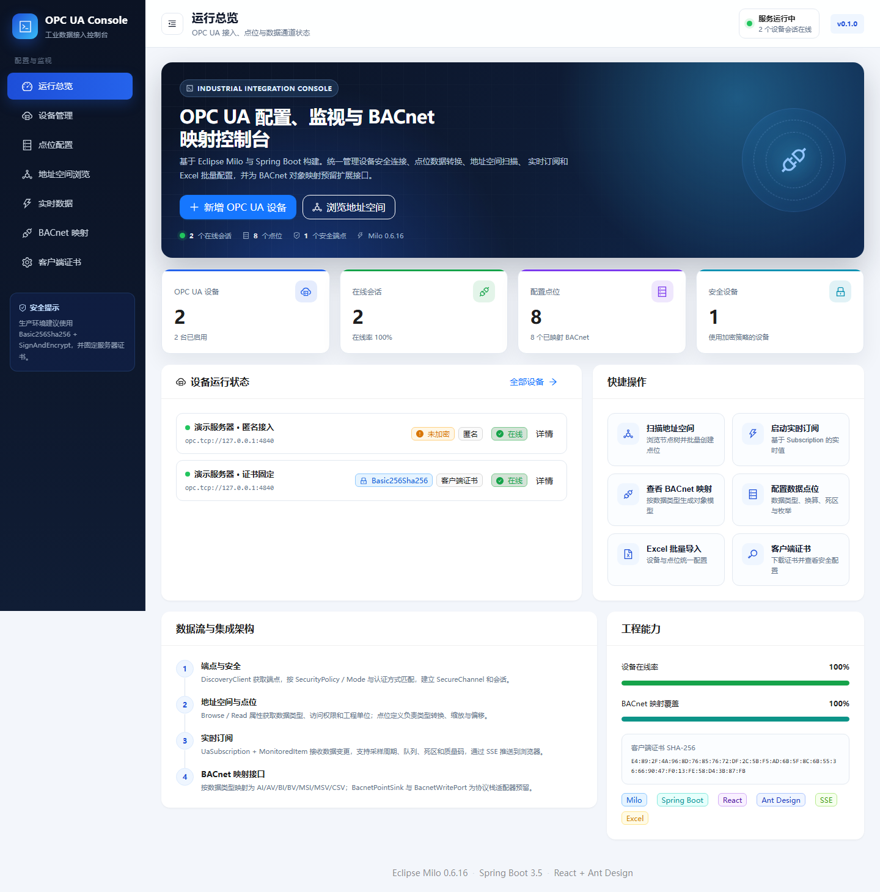
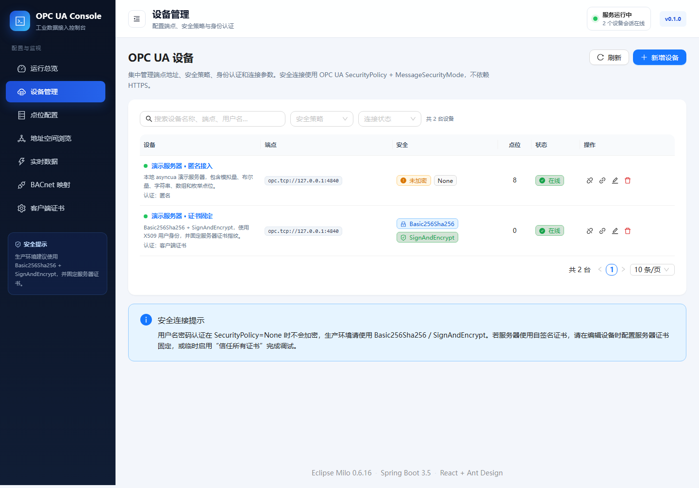
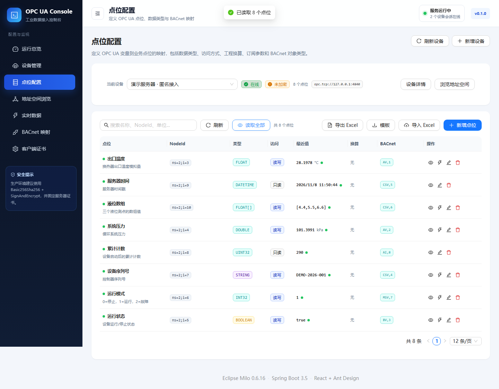
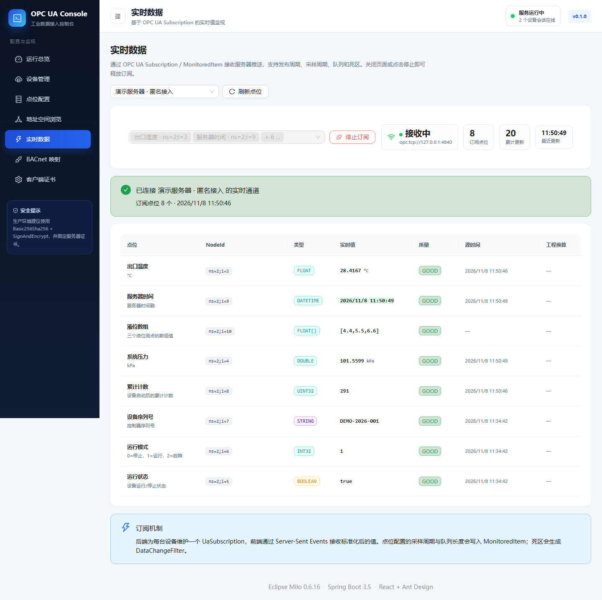
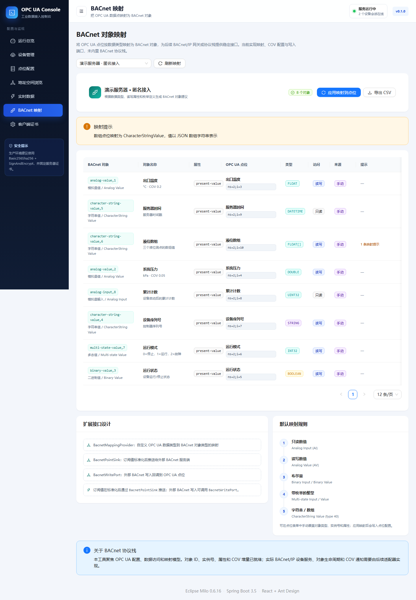

# OPC UA Web Console

基于 **Spring Boot + Eclipse Milo + React + Ant Design** 的 OPC UA 配置、监视与 BACnet 映射控制台。



| 设备与安全 | 点位与数据转换 |
| --- | --- |
|  |  |

| 实时订阅 | BACnet 映射 |
| --- | --- |
|  |  |

示例文件：`samples/opcua-demo-config.xlsx`（演示配置导出）、`samples/opcua-config-template.xlsx`（导入模板）。

## 1. 功能概览

| 领域 | 已实现能力 |
| --- | --- |
| 设备配置 | 端点地址、备注、启用状态、连接/请求/会话超时、订阅发布周期 |
| 安全连接 | SecurityPolicy：None / Basic128Rsa15 / Basic256 / Basic256Sha256 / Aes128_Sha256_RsaOaep / Aes256_Sha256_RsaPss；SecurityMode：None / Sign / SignAndEncrypt；自动生成本地应用实例证书；服务器证书固定（SHA-256 指纹）；可选择信任所有证书用于调试 |
| 身份认证 | Anonymous、UserNameIdentityToken、X509 用户证书认证 |
| 地址空间 | 懒加载节点树、变量属性查看、单点读取、递归扫描、批量创建点位 |
| 点位模型 | NodeId、数据类型、数组、读写权限、工程单位、描述、缩放/偏移、死区、采样周期、队列、枚举值、BACnet 覆盖字段 |
| 数据转换 | Boolean、整数/无符号整数、Float/Double、String、DateTime、Guid、ByteString、NodeId、QualifiedName、LocalizedText、ExtensionObject 读取；数组；工程值换算；写入类型校验与反算 |
| 数据访问 | 单点/批量读取、单点写入、质量码、源/服务器时间、数组写入 |
| 实时订阅 | Milo `UaSubscription` + `MonitoredItem`，采样周期、队列长度、绝对死区 `DataChangeFilter`，SSE 推送到浏览器 |
| Excel | 模板下载、配置导出、导入设备与点位；按 OPC UA 点位定义定义列；数据校验下拉；密码不导出 |
| BACnet | 按数据类型自动映射 AI/AO/AV、BI/BO/BV、MSI/MSO/MSV、CharacterStringValue (type 40)；显式覆盖；实例号分配；CSV 导出；`BacnetMappingProvider` / `BacnetPointSink` / `BacnetWritePort` 扩展点 |
| 运维 | 客户端证书查看/下载、运行状态、连接测试、端点探测、JSON 配置持久化、凭据 AES-GCM 加密 |

## 2. 技术栈

- 后端：Java 21、Spring Boot 3.5.16、Eclipse Milo 0.6.16、Apache POI 5.4.1
- 前端：React 18.3、TypeScript、Vite 7、Ant Design 5.29、React Router 6
- 存储：本地 JSON + 文件系统（无需数据库）
- 实时通道：Server-Sent Events（SSE）

## 3. 目录结构

```text
OPCUA-Web/
├─ backend/                  Spring Boot + Milo 后端
│  ├─ src/main/java/com/opcua/web/
│  │  ├─ bacnet/             BACnet 映射 SPI 与数据出口
│  │  ├─ controller/         REST / SSE 接口
│  │  ├─ domain/             设备、点位与枚举模型
│  │  ├─ dto/                请求/响应 DTO
│  │  ├─ event/              配置与连接事件
│  │  ├─ service/            OPC UA、Excel、转换、订阅、证书
│  │  └─ store/              JSON 配置存储
│  └─ src/main/resources/static/  构建时注入的前端静态资源
├─ frontend/                 React + Ant Design 控制台
├─ scripts/build.ps1         一键构建前端并打包可执行 jar
├─ scripts/run.ps1           启动打包后的应用
├─ tools/demo_opcua_server.py 可选的本地 OPC UA 演示服务器
└─ data/                     运行时配置、密钥与 PKI（自动生成）
```

## 4. 快速开始

### 4.1 环境要求

- JDK 21+（本项目在 Java 25 上验证）
- Node.js 20+ / npm
- Python 3.10+（仅可选的演示 OPC UA 服务器需要）

### 4.2 一键构建

Windows PowerShell：

```powershell
.\scripts\build.ps1
.\scripts\run.ps1
```

访问：<http://127.0.0.1:8088>

`build.ps1` 会依次执行前端安装/构建、把 `frontend/dist` 复制到后端静态资源、运行测试并打包 `backend/target/opcua-web.jar`。

### 4.3 开发模式

终端 1：

```powershell
cd backend
.\mvnw.cmd spring-boot:run
```

终端 2：

```powershell
cd frontend
npm install
npm run dev
```

开发页面：<http://127.0.0.1:5173>，Vite 会把 `/api` 代理到 8088。

### 4.4 启动演示 OPC UA 服务器（可选）

```powershell
pip install asyncua cryptography
python tools\demo_opcua_server.py
```

演示端点：`opc.tcp://127.0.0.1:4840`

- 匿名：允许
- 用户名密码：`admin / admin123`
- 安全策略：None、Basic256Sha256 Sign、Basic256Sha256 SignAndEncrypt
- 变量：`Objects/Demo/Line1/*`（温度、压力、运行状态、模式、序列号、计数、时间戳、数组）

工作区中的 `data/config.json` 已包含两台演示设备（匿名接入、证书固定），可直接体验。删除 `data/` 后应用会以空配置启动。

## 5. OPC UA 安全连接（关于“SSL”）

OPC UA 不通过 HTTPS 实现工业协议加密，而是使用：

- **SecurityPolicy**：消息签名/加密算法套件
- **MessageSecurityMode**：None / Sign / SignAndEncrypt
- **应用实例证书**：建立 SecureChannel 时校验双方身份
- **用户令牌**：Anonymous / UserName / X509 证书

控制台会自动生成本地客户端证书（`data/pki/client-cert.pem`、`client-key.pem`），可在“客户端证书”页面查看 SHA-256 指纹并下载 PEM。

### 5.1 服务器信任客户端

把 `client-cert.pem` 导入 OPC UA 服务器的 **Trusted/Clients** 列表后，服务器才会接受签名/加密连接和 X509 用户认证。

### 5.2 客户端信任服务器

两种方式：

1. **调试模式**：开启“信任所有服务器证书”，会跳过服务器证书信任校验，仅用于隔离网络调试。
2. **生产模式（推荐）**：关闭该开关，粘贴服务器证书 PEM；客户端会按 SHA-256 指纹固定服务器证书。也可以在连接测试结果中点击“从测试端点填入服务器证书”。

> 当 SecurityPolicy=None 时用户名密码不会加密，请勿在生产网络使用。

## 6. 点位与数据转换

### 6.1 读取

- 原始值：`rawValue`
- 工程值：`value = rawValue × scale + offset`
- 数据质量：`GOOD / UNCERTAIN / BAD`，同时返回 OPC UA StatusCode
- 数组按元素逐一换算
- DateTime 转换为 ISO-8601；ByteString 转换为 Base64；NodeId/QualifiedName 转换为可解析字符串

### 6.2 写入

- 写入前按配置的数据类型做范围与格式校验
- 工程值反算：`raw = (value - offset) / scale`
- 支持 Boolean、所有整数/无符号整数、Float/Double、String、DateTime、Guid、ByteString、NodeId、QualifiedName、LocalizedText
- 数组写入支持 JSON 数组 `[1,2,3]` 或逗号分隔
- `AUTO` 类型会读取服务器 DataType/ValueRank 后解析；无法识别时要求显式选择类型
- 只读点位会在服务端被拒绝写入
- 结构化类型（ExtensionObject）当前不支持通过 Web 写入

### 6.3 订阅

- 每台设备维护一个 `UaSubscription`
- 点位采样周期为 0 时使用 `samplingInterval = -1`（跟随发布周期）
- 死区 > 0 且为数值类型时创建绝对值 `DataChangeFilter`
- 点位变更会自动重建订阅
- 浏览器通过 `GET /api/devices/{id}/live?tagIds=...` 建立 SSE 通道
- 心跳事件 `ping` 保持连接；前端关闭页面后订阅自动释放

## 7. 地址空间浏览与扫描

- 节点树懒加载：`GET /api/devices/{id}/browse?nodeId=...`
- 单节点属性检查：`GET /api/devices/{id}/inspect?nodeId=...`
- 递归扫描：`POST /api/devices/{id}/scan`，可配置深度、最大变量数、是否包含属性
- 扫描结果可直接勾选并批量创建点位；重名会自动添加 ` (2)` 后缀
- 扫描会跳过远程节点和不可解析节点，并在结果中返回告警

## 8. Excel 导入/导出

### 8.1 工作表

| 工作表 | 内容 |
| --- | --- |
| `设备` | 设备名称、端点、安全策略/模式、认证方式、用户名、密码、超时、发布周期、启用、描述、设备ID |
| `点位` | 设备名称、点位名称、NodeId、数据类型、数组、访问方式、单位、描述、缩放/偏移/死区、采样、队列、枚举值、BACnet 类型/实例/属性/COV、启用、点位ID |
| `填写说明` | 字段解释与安全说明 |

- 导入匹配规则：设备按名称；点位按“设备 + 点位名称”
- `覆盖同名` 关闭时跳过已存在条目
- 密码不会导出；导入时密码留空表示保留现有密码，新设备使用用户名认证时必须填写密码
- 出于安全考虑，服务器证书 PEM 也不会导出；迁移安全设备后需重新配置固定证书
- 下载模板：`GET /api/excel/template`
- 导出配置：`GET /api/excel/export[?deviceId=...]`
- 导入：`POST /api/excel/import`（multipart，`file`、`overwrite`）

## 9. BACnet 映射

内置映射规则：

| OPC UA 类型 | 默认 BACnet 对象 |
| --- | --- |
| 只读数值 | Analog Input (AI, type 0) |
| 读写数值 | Analog Value (AV, type 2) |
| 只读布尔 | Binary Input (BI, type 3) |
| 读写布尔 | Binary Value (BV, type 5) |
| 带枚举的整型，只读 | Multi-state Input (MSI, type 13) |
| 带枚举的整型，读写 | Multi-state Value (MSV, type 19) |
| 字符串 / 数组 / 时间 | CharacterString Value (CSV, type 40) |

- 可以在点位表单中手动覆盖对象类型、实例号、属性和 COV 增量
- “应用映射到点位”会把对象类型和实例号写回配置
- CSV 导出：`GET /api/bacnet/devices/{id}/objects.csv`
- 外部数据出口：`BacnetPointSink`
- 外部写入回调：`BacnetWritePort`（当前默认只支持 `present-value`）
- 自定义映射：实现 `BacnetMappingProvider` 并注册为 Spring Bean，`order()` 小于 1000 即可优先于默认实现

> 本项目**不内置 BACnet/IP 协议栈**。对象 ID、实例号、属性、COV 配置和适配接口已就绪；实际 BACnet 设备服务、对象生命周期和 COV 通知由后续协议栈适配器实现。

## 10. REST API 摘要

| 方法 | 路径 | 说明 |
| --- | --- | --- |
| GET | `/api/meta` | 下拉选项与版本信息 |
| GET | `/api/dashboard` | 总览统计 |
| GET/POST | `/api/devices` | 设备列表 / 新建 |
| GET/PUT/DELETE | `/api/devices/{id}` | 设备详情 / 更新 / 删除 |
| POST | `/api/devices/test?existingId=` | 测试未保存配置 |
| POST | `/api/devices/{id}/connect` / `disconnect` | 建立/断开会话 |
| GET | `/api/devices/{id}/endpoints` | 探测服务器端点与证书 |
| GET | `/api/devices/{id}/browse` | 浏览子节点 |
| GET | `/api/devices/{id}/inspect` | 节点属性 |
| POST | `/api/devices/{id}/scan` | 递归扫描变量 |
| POST | `/api/devices/{id}/read` | 批量读取 |
| POST | `/api/devices/{id}/write` | 写入 |
| GET | `/api/devices/{id}/live` | SSE 实时值 |
| GET/POST/PUT/DELETE | `/api/tags...` | 点位 CRUD / 批量创建 |
| GET | `/api/excel/template` / `export` | Excel 下载 |
| POST | `/api/excel/import` | Excel 导入 |
| GET | `/api/bacnet/integration` | 扩展接口说明 |
| GET/POST | `/api/bacnet/devices/{id}/objects` / `apply` | 映射预览 / 应用 |
| POST | `/api/bacnet/write` | BACnet 写入端口 |
| GET | `/api/pki/info` / `client-certificate` | 客户端证书信息 / 下载 |
| GET | `/api/health` | 健康检查 |

错误响应：

```json
{
  "status": 400,
  "code": "VALIDATION_ERROR",
  "message": "参数校验失败",
  "details": { "errors": [{ "field": "name", "message": "设备名称不能为空" }] },
  "path": "/api/devices",
  "timestamp": "2026-01-01T00:00:00Z"
}
```

## 11. 运行数据与备份

默认数据目录为 `./data`，可用环境变量覆盖：

```powershell
$env:OPCUA_WEB_DATA_DIR = "D:\opcua-data"
java -jar backend\target\opcua-web.jar
```

| 文件 | 说明 |
| --- | --- |
| `data/config.json` | 设备、点位配置（密码为 AES-GCM 密文） |
| `data/secret.key` | 本地凭据加密密钥，丢失后旧密码无法解密 |
| `data/pki/client-cert.pem` | OPC UA 客户端证书 |
| `data/pki/client-key.pem` | 客户端私钥 |

备份时请同时备份 `config.json`、`secret.key` 和 `pki/`。

## 12. 测试

```powershell
cd backend
.\mvnw.cmd test
```

当前测试覆盖：

- 数据类型转换、工程缩放/反算、数组写入、DateTime/ByteString/UInt64、质量码
- BACnet 默认映射规则与覆盖
- Excel 模板与导出结构

前端生产构建：

```powershell
cd frontend
npm run build
```

端到端验证（本地）：

```powershell
# 启动演示 OPC UA 服务
python tools\demo_opcua_server.py

# 启动应用
.\scripts\run.ps1
```

已验证：匿名、用户名密码、X509 证书认证；Basic256Sha256 + SignAndEncrypt；服务器证书固定与错误证书拒绝；浏览、扫描、读写、数组、实时 SSE、Excel 往返、BACnet 映射与 CSV/写入端口。

## 13. 生产使用建议

- 本工具默认没有 Web 登录/RBAC，请部署在内网，或通过反向代理接入统一认证。
- 生产环境不要开启“信任所有服务器证书”。
- 替换演示客户端证书，妥善保护 `data/`。
- 对高采样率/大量点位，建议为订阅与写入服务增加连接池、限流和审计。
- 当前配置存储为单机 JSON；多实例部署应替换为共享数据库/配置中心。
- 结构化数据类型、历史数据、Alarm & Condition、Method Call 尚未在 UI 中实现。

## 14. 关键代码入口

- OPC UA 客户端与安全：`backend/src/main/java/com/opcua/web/service/OpcUaClientFactory.java`
- 连接生命周期：`OpcUaConnectionManager.java`
- 浏览/扫描：`OpcUaBrowseService.java`
- 读写与转换：`OpcUaValueService.java`、`OpcUaValueConverter.java`
- 实时订阅：`LiveService.java`
- Excel：`ExcelService.java`
- BACnet：`BacnetMappingService.java`、`backend/src/main/java/com/opcua/web/bacnet/`
- 前端页面：`frontend/src/pages/`
